

  

  Software engineering student at <b>ESPRIT</b> · Business Intelligence background 
  I build end-to-end products — clean APIs, reliable data models, and interfaces that feel simple.

   

  <code>NOW</code> Building <a href="https://github.com/Skander-Bardaoui/PI-DEV-FRONT">NovaEntra</a> &amp; the AI oral-exam coach &nbsp;·&nbsp; <code>TARGET</code> PFE 2026 — Full-Stack / BI &nbsp;·&nbsp; <code>BASE</code>

  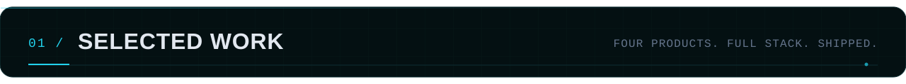

  <a href="https://github.com/Skander-Bardaoui/PI-DEV-FRONT">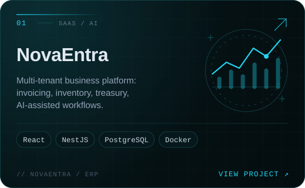</a>
  <a href="https://github.com/Skander-Bardaoui/ChillNet">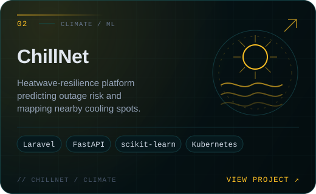</a>
  <a href="https://github.com/Skander-Bardaoui/EduSpark">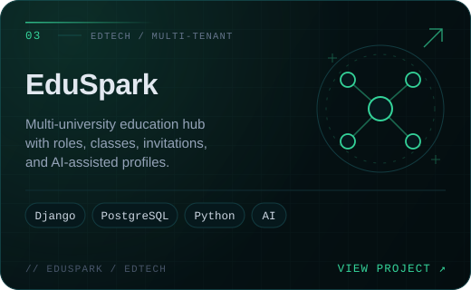</a>
  <a href="https://github.com/Skander-Bardaoui/Gestion-Formation-Front">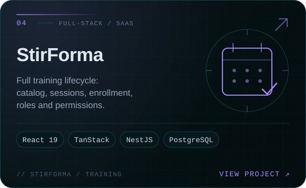</a>

  MORE WORK &nbsp;·&nbsp; <a href="https://github.com/Skander-Bardaoui/Geo-Api">GeoFilter API</a> &nbsp;·&nbsp; <a href="https://github.com/Skander-Bardaoui/Urbanlink-Symfony">UrbanLink</a> &nbsp;·&nbsp; <a href="https://github.com/Skander-Bardaoui/Human-Resource-Management-Module-Laravel">HR Management</a> &nbsp;·&nbsp; <a href="https://github.com/Skander-Bardaoui?tab=repositories">All repositories →</a>

  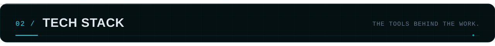

  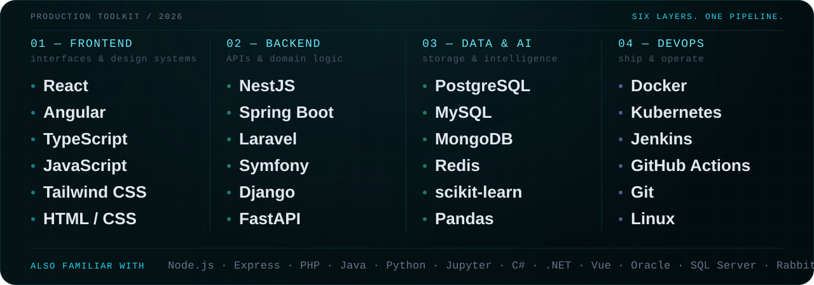

  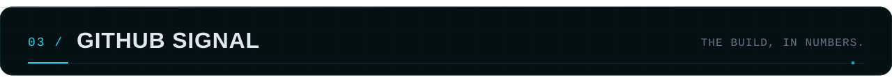

  <a href="https://github.com/Skander-Bardaoui?tab=repositories">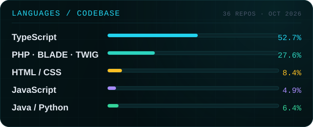</a>
  <a href="https://github.com/Skander-Bardaoui">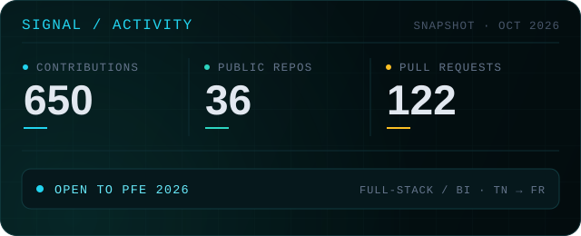</a>

  <picture>
    <source media="(prefers-color-scheme: dark)" srcset="https://raw.githubusercontent.com/Skander-Bardaoui/Skander-Bardaoui/output/github-contribution-grid-snake-dark.svg?v=2" />
    <source media="(prefers-color-scheme: light)" srcset="https://raw.githubusercontent.com/Skander-Bardaoui/Skander-Bardaoui/output/github-contribution-grid-snake.svg?v=2" />
    
  </picture>

  <a href="mailto:skander.bardaoui@esprit.tn?subject=Let%27s%20build%20something">
    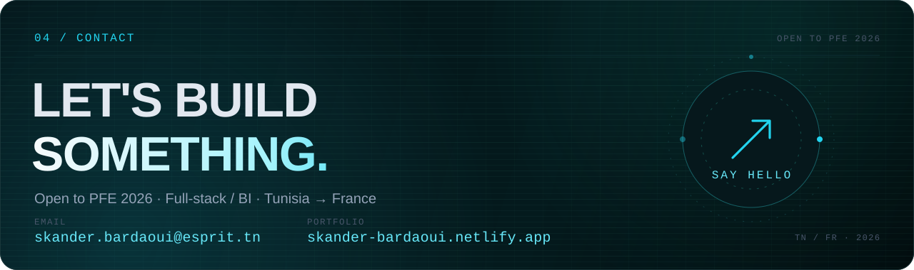
  </a>

  

  © 2026 Skander Bardaoui · Designed &amp; built from scratch

